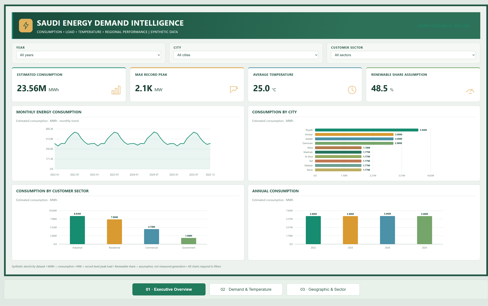
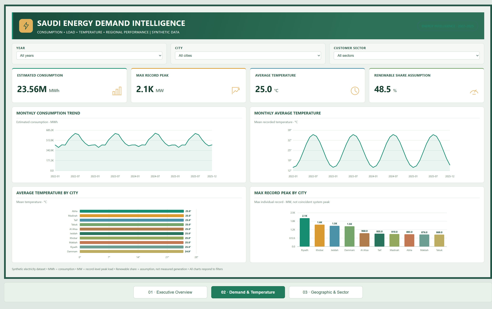
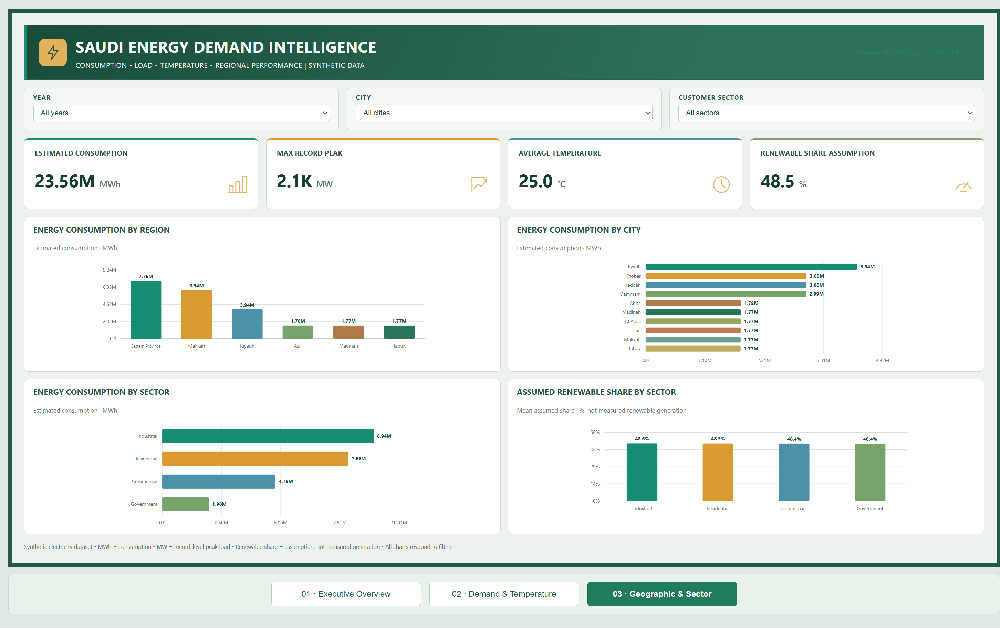

# Saudi Energy Demand & Load Analytics | 2022–2025

**Excel · SQL · Python · Energy-sector data visualization**

> **Synthetic data disclosure:** This is a fictional Saudi energy-demand scenario for portfolio demonstration. Estimated consumption and peak load are not real electricity-grid measurements. Renewable shares are assumptions, not verified generation figures.

## Executive dashboard



### Project overview

Analyze **58,440 synthetic daily city-sector observations** across 10 Saudi cities and four customer sectors (2022–2025). The objective is to understand electricity consumption, geographic and sector demand, temperature-related patterns, and modeled renewable-energy shares.

| Indicator | Dataset result |
|---|---:|
| Estimated electricity consumption | **23.56M MWh** |
| Observations | **58,440** |
| Maximum individual-record peak load | **2,059 MW** |
| Mean recorded temperature | **24.98°C** |
| Mean assumed renewable share | **48.46%** |
| Cities / sectors | **10 / 4** |

## Dashboard gallery

### 01 — Executive Summary


Overview of energy consumption, key indicators, monthly trends, city comparisons, and sector demand.

### 02 — Demand & Temperature



Seasonal demand, temperature bands, and individual-record peak-load comparisons.

### 03 — Geographic & Sector



Regional and city demand, sector composition, and assumed renewable-share comparisons.

The dashboards use a **grid-green, solar-gold, and hydro-blue palette**. The images are screenshots; [launch the interactive website](https://ahmedfazil007.github.io/Saudi-Energy-Demand-Load-Analytics/) to explore the working report.

## Key findings and recommendations

1. **Sector demand concentration:** Industrial represents approximately **8.94M MWh (37.93%)**, followed by Residential at **7.86M MWh (33.37%)**. **Recommendation:** Prioritize forecasting scenarios for these sectors.
2. **Geographic demand concentration:** Riyadh contributes approximately **3.94M MWh (16.74%)**. **Recommendation:** Review seasonal patterns and peak-load profiles for Riyadh.
3. **Annual consumption stability:** Annual totals are approximately **5.88–5.90M MWh**. **Recommendation:** Analyze monthly and seasonal variation rather than annual totals alone.

These are descriptive insights; they do not establish causality or demonstrate actual operational savings.

## Excel, SQL and Python

| File | Description |
|---|---|
| [Interactive dashboard (HTML)](dashboard/index.html) | Redesigned three-page browser-based report |
| [Excel analytics workbook](excel/Saudi_Energy_Demand_Analysis.xlsx) | KPI summaries, tables, and charts |
| [SQL queries](sql/energy_analysis.sql) | Six SQLite-compatible analysis queries |
| [Python CSV-to-SQLite loader](python/load_sqlite.py) | Imports the source CSV into a local database |
| [Python analytical summaries](python/analyze_energy.py) | Validates observations and exports grouped results |

### How to reproduce

1. Use the included source dataset at `data/03_energy_daily_synthetic.csv`.
2. From the repository root, run `python python/load_sqlite.py` to create the local SQLite database.
3. Run `python python/analyze_energy.py` to generate annual, monthly, city, region, and sector summaries.
4. Open the Excel workbook to review KPI summaries and charts.
5. Download `dashboard/index.html` and open it in Chrome or Edge to use the interactive dashboard.

Python scripts use the standard library and require no additional pip packages.

## Repository structure

```text
Saudi-Energy-Demand-Load-Analytics/
├── index.html                    # GitHub Pages landing redirect
├── README.md
├── assets/
│   ├── SEDI_Executive-Summary.png
│   ├── SEDI_Demand&Temparature.png
│   └── SEDI_Geographic&Sector.png
├── dashboard/
│   └── index.html                # Interactive three-page dashboard
├── data/
│   └── 03_energy_daily_synthetic.csv
├── excel/
│   └── Saudi_Energy_Demand_Analysis.xlsx
├── python/
│   ├── analyze_energy.py
│   └── load_sqlite.py
└── sql/
    └── energy_analysis.sql
```

**[Launch the live dashboard](https://ahmedfazil007.github.io/Saudi-Energy-Demand-Load-Analytics/)** · [Open dashboard HTML](dashboard/index.html) · [Download source dataset](data/03_energy_daily_synthetic.csv)

## Data interpretation

- **MWh** measures energy consumption; **MW** measures power. A maximum single-record MW value must not be described as a simultaneous system-wide peak.
- `renewable_share_assumption` is modeled, not measured.
- This is a portfolio demonstration, not a live production energy monitoring system.
- The dashboard is HTML-based, **not** a native Power BI (.pbix) or Tableau (.twbx) file.

---
**Skills demonstrated:** Excel · SQLite · Python · Data validation · KPI reporting · Energy analytics · Business intelligence · Dashboard visualization
